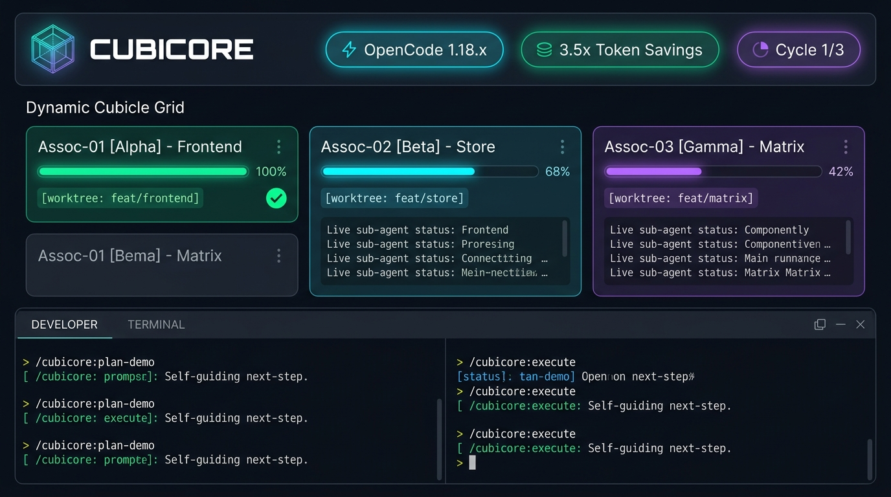
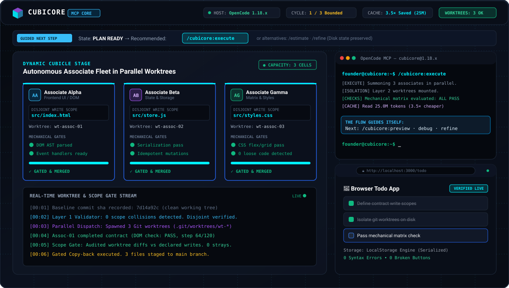
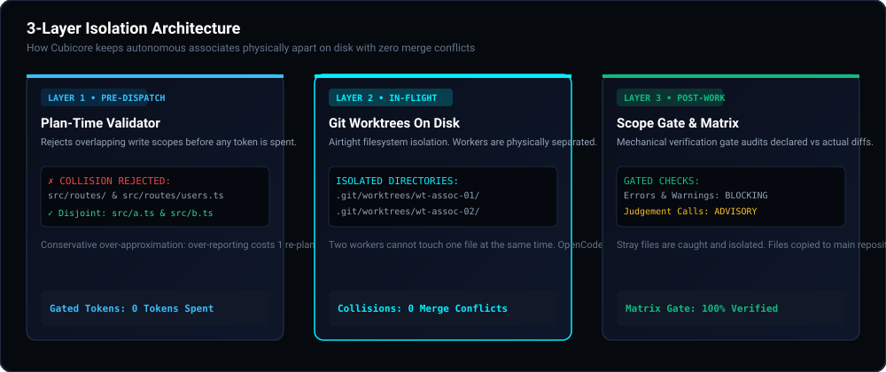

# Cubicore ⬡

> **Dynamic Multi-Agentic Factory of Sub-Agents**  
> *Utilizing the Decrease-and-Conquer Technique to turn solo developers into founders commanding an autonomous engineering fleet.*

[](#)
[](#supported-ai-agents)
[](#the-honest-claim--benchmarks)
[](#how-associates-are-kept-apart)
[](#finite-bounded-loops)

---

## 📸 Working Model Showcase

### 1. High-Resolution Developer Cockpit


### 2. Live Dynamic Cubicle & Parallel Execution Grid


*Live visual telemetry showing the Dynamic Cubicle grid scaling dynamically, associate sub-agents executing in isolated Git worktrees, the 14-command terminal with self-guiding cues, and the localhost live preview.*

---

## 📑 Table of Contents
1. [Introduction & Core Philosophy](#-introduction--core-philosophy)
2. [How the Dynamic Cubicle Works](#-how-the-dynamic-cubicle-works)
3. [The Flow Guides Itself & 14 Commands](#-the-flow-guides-itself--14-commands)
4. [How Associates Are Kept Apart (3-Layer Isolation)](#-how-associates-are-kept-apart-3-layer-isolation)
5. [The Honest Claim & Empirical Benchmarks](#-the-honest-claim--empirical-benchmarks)
6. [Supported AI Agents Ecosystem](#-supported-ai-agents-ecosystem)
7. [Artifacts & Contracts System](#-artifacts--contracts-system)
8. [Installation & Setup](#-installation--setup)
9. [Running the Frontend Dashboard](#-running-the-frontend-dashboard)

---

## 🏢 Introduction & Core Philosophy

**Cubicore** originated from the concept of **"Cores in a Cubicle"**, or informally, **"A Fleet of Engineers in a Company"**. 

What if you wished to build an entire company right at home, where **you are the founder** and fellow sub-agents perform the engineering work for you? Cubicore provides an MCP (Model Context Protocol) factory architecture designed to finish projects faster, with zero git collisions and radical token savings.

### The Dynamic Cubicle
The "Cubicle" in Cubicore scales dynamically:
1. **Prompt to Cubicle**: You provide a request in plain words without a spec.
2. **Dynamic Expansion**: The Cubicle scales its cell capacity to match the contract requirements of your project.
3. **Capacity Lock**: Size stops expanding once the planning phase concludes.
4. **Parallel Execution**: Dispatches sub-agents simultaneously (**1 task : 1 associate agent**), filling the cubicle.
5. **Mechanical Verification**: Audits broken layouts, unlinked buttons, loose code, and syntax errors, fixing them automatically.
6. **Live Preview & Deploy**: Runs the app locally for founder inspection and prepares deployment stacks.

---

## 📐 How the Dynamic Cubicle Works

```
                                [ Founder Request ]
                                         │
                                         ▼
                               /cubicore:plan-demo
                               /cubicore:plan-full
                                         │
                         ┌───────────────┴───────────────┐
                         ▼                               ▼
                 [ Phase 1: Prepare ]            [ Phase 2: Research ]
                 - Git baseline recorded         - Module tree exports scanned
                 - Clean commit sha logged       - No shell wandering
                         │                               │
                         └───────────────┬───────────────┘
                                         ▼
                            [ Phase 3: Dynamic Cubicle ]
                           *Scales cells to contract count*
                                         │
                         ┌───────────────┼───────────────┐
                         ▼               ▼               ▼
                   [Associate 1]   [Associate 2]   [Associate 3]
                   (Scope: UI)     (Scope: Store)  (Scope: Test)
                         │               │               │
                         └───────────────┬───────────────┘
                                         ▼
                            [ Phase 4: Parallel Dispatch ]
                            *Isolated Git Worktrees on Disk*
                                         │
                                         ▼
                            [ Phase 5: Mechanical Matrix ]
                           *Checks gated; auto-repairs applied*
                                         │
                                         ▼
                            [ /cubicore:preview & deploy ]
```

---

## 🧭 The Flow Guides Itself & 14 Commands

Every reply from Cubicore ends with **what to type next** and the recommended alternatives. This recommendation is derived strictly from state on disk, so it survives restarts, context clearing, or continuing days later.

### State Transitions Table

| State on Disk | Primary Recommended Step | Alternative Options |
|---|---|---|
| `no plan` | `/cubicore:plan-demo` | `/cubicore:plan-full` |
| `after plan` | `/cubicore:execute` | `/cubicore:estimate`, `/cubicore:refine` |
| `run in flight` | `/cubicore:status` | `/cubicore:status` |
| `after the run` | `/cubicore:preview` | `/cubicore:debug`, `/cubicore:refine`, `/cubicore:undo`, `/cubicore:continue` |
| `issues found` | `/cubicore:debug` | `/cubicore:refine`, `/cubicore:undo`, `/cubicore:continue` |
| `everything passes` | `/cubicore:deploy` | `/cubicore:preview`, `/cubicore:refine`, `/cubicore:undo` |

---

### Command Dictionary

| Command | Category | Operational Purpose |
|---|---|---|
| `/cubicore:plan-demo` | Planning | Demo/MVP mode. Researches repo, asks clarifying questions, and writes `CUBICORE_PLAN.md` & `JSON`. Dispatches nothing. |
| `/cubicore:plan-full` | Planning | Full product mode of above. Scopes 6–12 contracts (API, frontend, storage, checks). Dispatches nothing. |
| `/cubicore:execute` | Execution | Dispatches the plan. One brief per associate, summoned in parallel in isolated worktrees. Enforces cycle budget. |
| `/cubicore:continue` | Resumption | Resumes the last run from where it stopped. Skips already passing contracts; exempt from cycle budget. |
| `/cubicore:debug` | Matrix Verification | Reviews, tests, and auto-fixes mechanical issues. Writes `CUBICORE_DEBUG.md`. Judgement calls never block. |
| `/cubicore:refine` | Iteration | Mandatory iterative editing command. Adds features or alters code without destroying previously passed contracts. |
| `/cubicore:estimate` | Budgeting | Calculates token and wall-clock ceilings and associate ownership matrix before spending a single token. |
| `/cubicore:preview` | Verification | Runs the application on localhost using the plan's preview block. Verifies CLI/GUI/TUI interfaces. |
| `/cubicore:deploy` | Delivery | Inquires on deployment tiers (Edge/Static/Docker), writes configuration files, and outlines manual steps. Deploys nothing. |
| `/cubicore:status` | Telemetry | Reports what in-flight worktrees are executing, waiting for completion if active. |
| `/cubicore:undo` | Recovery | Discards the last execution and returns working tree to baseline commit recorded during preparation. |

---

## 🛡️ How Associates Are Kept Apart (3-Layer Isolation)

OpenCode 1.18.x permissions are per-action, not per-resource—an agent cannot be restricted to a path by prompt instructions alone. Cubicore enforces separation through three structural layers:



1. **Layer 1: Plan-Time Validator (Pre-Dispatch)**
   - Conservative over-approximation of write scopes.
   - Rejects overlapping paths (e.g. `src/routes/` and `src/routes/users.ts`) before a single token is spent.
   - Over-reporting costs 1 re-plan; under-reporting costs a git merge conflict.
2. **Layer 2: Per-Associate Git Worktrees (In-Flight)**
   - Airtight filesystem boundary.
   - Associate Alpha works in `.git/worktrees/wt-assoc-01/`; Associate Beta works in `.git/worktrees/wt-assoc-02/`.
   - Two workers physically cannot edit the same file simultaneously.
3. **Layer 3: Scope Gate & Mechanical Verification Matrix (Post-Work)**
   - Audits actual changed files against declared contract write scopes.
   - Stray files are caught and isolated.
   - Mechanical errors and warnings **BLOCK** merge; founder judgement calls are **ADVISORY**.

---

## 📊 The Honest Claim & Empirical Benchmarks

Splitting work without coordination is **not free parallelism**. Measured against one agent doing the same job, twelve uncoordinated workers cost **10.9× the tokens** and were **2.6× slower** due to context duplication and git collisions.

### Key Metrics
- **Cubicore Token Efficiency**: **3.5× cheaper** on cache reads against naive 12-worker fan-out (**25.0M tokens vs 96.0M tokens**). Narrow disjoint write scopes ensure workers only load what their contract requires.
- **Single Agent Comparison**: On twelve small files, Cubicore broke even on wall-clock time and cost **3.1× more tokens**. The work was too small to benefit from parallelism—the model was the bottleneck.
- **Merge Conflicts**: **0 collisions** across all test fixture runs.

### When Cubicore Pays Off
| Situation | Cubicore Verdict | Technical Reason |
|---|---|---|
| **Several hours of genuinely independent work** | **Worth It** | 3.5× cheaper cache tokens than naive fan-out; zero merge conflicts. |
| **A couple of hours, or one sitting** | **Overhead** | 3.1× tokens for wall-clock parity. A single agent is faster. |
| **Coupled work, shared core, tight integration** | **Refused** | Topology validator catches it before a token is spent. |
| **One agent, done in one pass** | **Overhead** | Plan explicitly advises you to use standard prompt. |

> *"The real value is not speed. It is that four agents can work on the same repository without colliding, and that 'done' means the checks passed rather than that a model said so."*

---

## 🤖 Supported AI Agents Ecosystem

| Agent | Status | Architectural Mechanism | Implementation Progress |
|---|---|---|---|
| **OpenCode** | ✅ **Done** | Worktrees + Filesystem Gates | Primary production runtime (Native CLI/Desktop & Flatpak). Bounded to 120 steps. |
| **Claude Code** | ⏰ **Scheduled** | Inline Sub-Tasks | Sub-task dispatch integration scheduled for v1.2. |
| **Codex** | ⏰ **In Progress** | Sub-Task Graph | Has inline sub-tasks; undergoing context token reduction. |
| **Cursor** | ⏰ **Planned** | Session Multiplexing | Architecture design for session-only integration. |
| **Windsurf** | ⏰ **Evaluating** | Cascade Bridge | Researching Inline Sub-tasks vs Sessions dispatch. |

---

## 📑 Artifacts & Contracts System

Cubicore generates auditable artifacts on disk:
- **`CUBICORE_PLAN.md`**: Human-readable blueprint with executive summary, contracts, and graph budget.
- **`CUBICORE_PLAN.json`**: Dispatchable AST schema with write scopes and test check commands.
- **`CUBICORE_CONTEXT.md`**: Narrative context written for human founders presenting the project (Problem, Users, Benefits, Demo Flow, Risks, and The Ask). *Never parsed by Execute or dispatch.*
- **`CUBICORE_DEBUG.md`**: Detailed mechanical verification report with automated AST and DOM fixes.

---

## ⚡ Installation & Setup

```bash
# Global setup for your user account (never installs into project repo)
npx cubicore@latest setup
```

The installer will:
1. Detect your OpenCode runtime (**Native CLI/Desktop** or **Flatpak**).
2. Copy the MCP runtime into your global user config directory.
3. Register `mcp.cubicore` and provision the associate fleet (bounded to 120 steps).

To launch in any project repository:
```bash
/cubicore:plan-demo
```

---

## 🚀 Running the Frontend Dashboard

A complete interactive visual cockpit is included in this repository:

### 1. Direct Launch
Open `index.html` directly in your browser:
```bash
start c:\Users\Dhanush\cubicore\index.html
```

### 2. Local HTTP Server
```powershell
cd c:\Users\Dhanush\cubicore
python -m http.server 3000
```
Open your browser to: **[http://localhost:3000](http://localhost:3000)**

### Dashboard Features:
- **Dynamic Cubicle Visualizer**: Watch cubicle cells provision and scale dynamically.
- **14-Command Terminal**: Execute simulated commands with self-guiding next-step cues.
- **Live App Preview**: Working interactive Todo List and Personal Finance Tracker with real CSV file exports.
- **Interactive Collision Tester**: Test path overlaps in real time using Layer 1 logic.
- **Artifact Inspector**: Review `PLAN.md`, `PLAN.json`, `CONTEXT.md`, and `DEBUG.md`.

---

## ⚖️ License
MIT License. Built for autonomous developer-founders.
